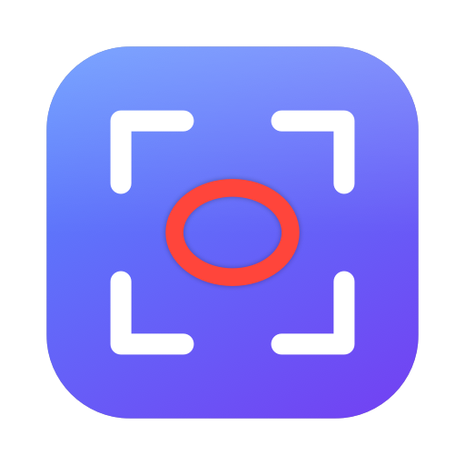
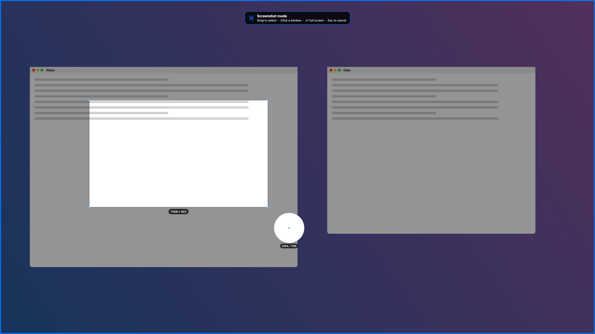
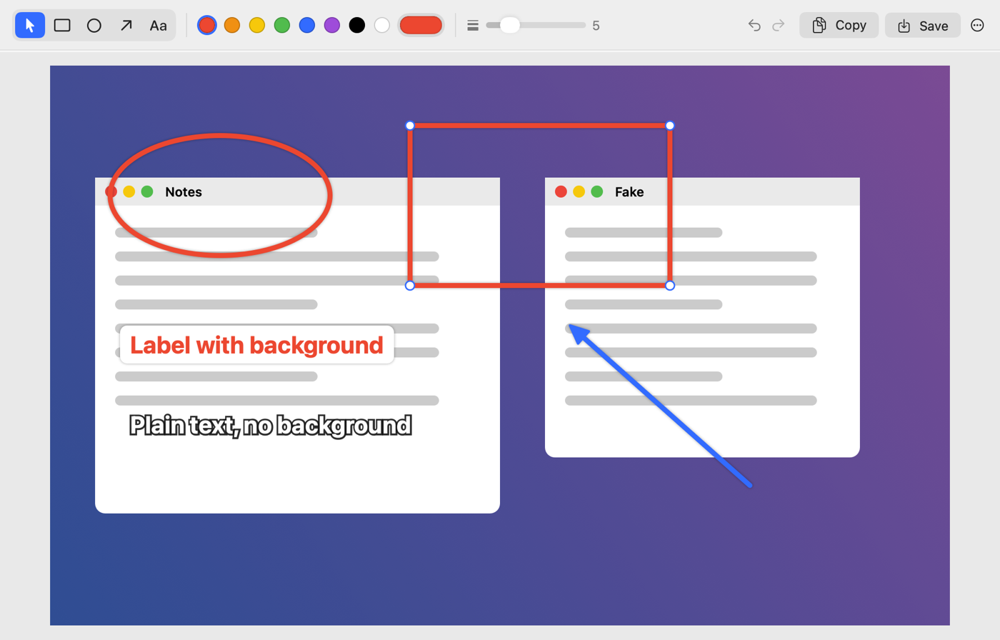

<p align="center">
  
</p>

<h1 align="center">EasyScreen</h1>

<p align="center">
  A free, open-source screenshot tool for Apple Silicon Macs.<br>
  Lives in your menu bar · <b>⇧⌘1</b> to grab a region · annotate · copy, save, or both at once.
</p>

<p align="center">
  <a href="https://github.com/phastings503cm/EasyScreen/releases/latest"><b>Download the latest DMG</b></a>
</p>

---



## Features

- **Menu bar app that starts at login** — no Dock icon until you open the editor or settings.
- **Region capture with ⇧⌘1** (changeable). Screenshot mode is unmistakable: the screen freezes and dims,
  an accent border and a "Screenshot mode" banner appear, plus crosshair guides, a pixel loupe and a live size readout.
  - Drag to select a region · **Shift** for a square · **Option** to draw from the centre · hold **Space** to move the selection
  - **Click** a window to capture just that window, or click the desktop / press **Return** for the whole screen
  - **Esc** or right-click to cancel
- **After-capture actions you can combine** — tick any of these and they all run at the same time on every capture:
  - Open in editor
  - Copy to clipboard
  - Save to a folder (PNG or JPEG, custom filename prefix)
- **Annotation editor**
  - Rectangles/squares, circles/ellipses, arrows, and text — **with or without a background label**
  - Colour swatches + full colour picker, line thickness, font size
  - Select, move, resize and delete annotations; full undo/redo; zoom
  - **Copy** (⌘C) or **Save** (⌘S) the annotated image; *Save As…* for anywhere else
- **Custom keyboard shortcuts** for capture region, capture full screen, and opening settings.
- Retina-aware: output keeps full resolution and the right DPI.
- Built natively in Swift with ScreenCaptureKit. No dependencies, no analytics, no network access.



## Install

1. Download `EasyScreen-<version>-arm64.dmg` from [Releases](https://github.com/phastings503cm/EasyScreen/releases/latest).
2. Open the DMG and drag **EasyScreen** into **Applications**.
3. Open EasyScreen from Applications.
   - Release builds are not notarized by Apple (unless the maintainer adds signing secrets — see below), so the first launch is blocked.
     Go to **System Settings → Privacy & Security** and click **Open Anyway**, or run:
     ```bash
     xattr -dr com.apple.quarantine /Applications/EasyScreen.app
     ```
4. When prompted, allow **Screen Recording** (System Settings → Privacy & Security → Screen & System Audio Recording), then relaunch EasyScreen (Settings has a **Relaunch** button).

**Requirements:** an Apple Silicon Mac (M1 or newer) running macOS 14 Sonoma or later.

> **Note:** recent macOS versions occasionally re-confirm that screen-capture apps may keep recording; choose **Allow** if asked.
>
> **Updating:** macOS ties the Screen Recording permission to the app's code signature. Ad-hoc–signed builds get a new signature
> every release, so after updating you may need to toggle EasyScreen off and on again under Screen & System Audio Recording.

## Using it

| Action | How |
| --- | --- |
| Capture a region | **⇧⌘1**, or menu bar icon → *Capture Region* |
| Capture full screen | menu bar icon → *Capture Full Screen* (assign a shortcut in Settings) |
| Choose what happens after capture | Settings → *After capture*, or the menu bar icon's quick toggles |
| Change shortcuts | Settings → *Keyboard shortcuts* → click a shortcut and type a new one (⌫ clears, Esc cancels) |
| Annotate an existing image | menu bar icon → *Open Image…* |

### Editor shortcuts

| Key | Tool / action |
| --- | --- |
| V · R · O · A · T | Select · Rectangle · Circle · Arrow · Text |
| Shift while drawing | Square / circle / 45° arrow |
| Double-click text | Edit it (Return finishes, Shift-Return adds a line) |
| ⌫ | Delete selected annotation |
| Arrow keys (+ Shift) | Nudge selection 1 pt (10 pt) |
| ⌘Z / ⇧⌘Z | Undo / redo |
| ⌘C · ⌘S · ⇧⌘S | Copy · Save · Save As |
| ⌘0 · ⌘9 · ⌘+ · ⌘- | Actual size · Zoom to fit · Zoom in · Zoom out |
| Esc | Deselect, then close |

## Build from source

Requires Xcode 16 or newer (Swift 5.10+).

```bash
swift test                          # unit tests
VERSION=1.0.0 ./scripts/build-app.sh   # → build/EasyScreen.app (arm64 only)
VERSION=1.0.0 ./scripts/make-dmg.sh    # → build/EasyScreen-1.0.0-arm64.dmg
open build/EasyScreen.app
```

To exercise the real ScreenCaptureKit capture and global-hotkey registration (needs Screen Recording permission for your terminal; pixels are only measured in memory):

```bash
EASYSCREEN_LIVE_TESTS=1 swift test --filter LiveSystemTests
```

To render the overlay, editor and settings UI to PNGs for a visual check:

```bash
EASYSCREEN_SNAPSHOT_DIR=/tmp/easyscreen-shots swift test --filter SnapshotRenderTests
```

## Releases (CI)

[`.github/workflows/build.yml`](.github/workflows/build.yml) runs on every push and pull request on a GitHub Apple Silicon runner:
it runs the tests, builds the arm64 app, packages the DMG and uploads it as a build artifact.

Pushing a tag like `v1.2.0` additionally publishes a GitHub Release with the DMG and its SHA-256:

```bash
git tag v1.2.0
git push origin v1.2.0
```

### Optional: Developer ID signing & notarization

Add these repository secrets and CI will sign with your Developer ID and notarize the DMG, so users can open it without the Gatekeeper workaround:

| Secret | Value |
| --- | --- |
| `MACOS_CERTIFICATE_P12` | Base64 of your *Developer ID Application* certificate exported as .p12 |
| `MACOS_CERTIFICATE_PASSWORD` | Password for that .p12 |
| `MACOS_SIGN_IDENTITY` | e.g. `Developer ID Application: Your Name (TEAMID)` |
| `APPLE_ID` | Apple ID email used for notarization |
| `APPLE_TEAM_ID` | Your 10-character team ID |
| `APPLE_APP_PASSWORD` | An [app-specific password](https://support.apple.com/102654) for that Apple ID |

## License

[MIT](LICENSE) © 2026 Patrick Hastings
